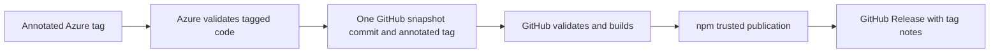

# Tag releases through GitHub

Azure DevOps is the development repository. GitHub (`sqnfa/passwords-sqnfa-web`, branch `main`) is the publication mirror. Each annotated Azure tag produces one GitHub snapshot commit, an annotated GitHub tag with the same release notes, an npm publication, and a GitHub Release. Existing GitHub history stays in place; Azure development commits are not imported.



The implementation is [azure-pipelines.release.yml](../azure-pipelines.release.yml), [.github/workflows/release.yml](../.github/workflows/release.yml), and [scripts/release](../scripts/release). Neither service needs an npm token. The Azure PAT used to push development changes is not a pipeline credential.

## GitHub App and Azure credentials

1. Create a GitHub App in your account or the `sqnfa` organization's **Settings → Developer settings → GitHub Apps**. A webhook is not needed. Grant these repository permissions:
   - **Contents: Read and write** for snapshot commits and tags.
   - **Workflows: Read and write** because the snapshot includes `.github/workflows`.
   - **Metadata: Read-only**, which GitHub supplies automatically.
2. Install the App in `sqnfa`, selecting only `passwords-sqnfa-web`. Record the **App ID** from its settings and the **installation ID** from the installed App's configuration URL (`.../installations/<id>`).
3. Generate an App private key. Rename the downloaded PEM file to `github-release-mirror.pem` and upload it in Azure DevOps, project **sine qua non for applications → Pipelines → Library → Secure files**. Authorize only the release pipeline to download this file. The download task removes its temporary copy when the job finishes.
4. In **Pipelines → Library → Variable groups**, create `github-release-mirror` with:

   | Variable               | Value                            | Secret? |
   | ---------------------- | -------------------------------- | ------- |
   | `githubAppId`          | The GitHub App's numeric App ID  | No      |
   | `githubInstallationId` | The repository installation's ID | No      |

   Authorize the release pipeline to use this group. The private key belongs in Secure Files, not a variable, Git, or GitHub secrets.

The script signs a short-lived App JWT, obtains an installation token restricted to this repository and the two write permissions, and supplies Git authentication through process environment settings. Tokens are not stored in remote URLs or Git configuration. The installation token is revoked after use.

If GitHub branch/tag rules restrict pushes, allow the installed App to update the publication branch and create release tags. Keep development in Azure; direct edits and merged Dependabot PRs in GitHub would be replaced by the next exact snapshot.

## Azure pipeline setup

1. In **Pipelines → Environments**, create `github-release-mirror`. Under **Approvals and checks**, add an **Exclusive lock** check. The mirror stage uses `lockBehavior: sequential`, so tag builds update GitHub one at a time.
2. Create an Azure Pipeline for this Azure Repos repository using **Existing Azure Pipelines YAML file**, selecting `/azure-pipelines.release.yml`. Save the pipeline. Authorize its variable group, secure file, and environment if prompted. It triggers on `v*` tags and ignores ordinary branch pushes and PRs.
3. `githubRepository` and `githubMirrorBranch` at the top of that YAML select the destination. If changing the destination, also update `package.json`'s `repository.url` and the npm trusted publisher; the scripts reject mismatched repositories.

Validation runs before the App key is downloaded. Both Azure and GitHub check the library, release automation, Angular production build, browser examples, and dependency audits. Runners use Node 24.

## GitHub and npm setup

1. Enable GitHub Actions in `sqnfa/passwords-sqnfa-web`.
2. In the repository's **Settings → Environments**, create an environment named `npm`. The publish job uses that exact environment name. You may restrict deployment to `v*` tags.
3. As an owner of `passwords-sqnfa-web`, open its **Settings → Trusted publishing** on [npmjs.com](https://www.npmjs.com/package/passwords-sqnfa-web). Add a **GitHub Actions** publisher:

   | Field                | Value                      |
   | -------------------- | -------------------------- |
   | Organization or user | `sqnfa`                    |
   | Repository           | `passwords-sqnfa-web`      |
   | Workflow filename    | `release.yml`              |
   | Environment name     | `npm`                      |
   | Allowed actions      | Allow direct `npm publish` |

   Enter the workflow filename alone, not `.github/workflows/release.yml`. No npm secret, `NPM_TOKEN`, or `NODE_AUTH_TOKEN` is needed. GitHub supplies the short-lived OIDC identity and automatic `GITHUB_TOKEN`; the workflow grants only the publishing job `id-token: write` and `contents: write`.

The workflow file reaches GitHub with the first snapshot. If npm requires it to exist before saving the publisher, push the first release tag after completing the Azure/App setup, then configure the trusted publisher once `release.yml` appears in GitHub. If the first publish attempt failed before configuration was complete, rerun that GitHub Release workflow. The workflow creates the GitHub Release only after npm publication succeeds.

The public GitHub repository allows npm provenance generation. The publish job pins npm 12.2.0 instead of following `npm@latest`, so CLI updates are reviewed before they affect publication. This npm version requires Node 22.22.2+, 24.15.0+, or 26+; the runner uses Node 24. Trusted publishing requires npm 11.5.1+ and Node 22.14.0+. The job rebuilds without cached dependencies and publishes the verified tarball with `--provenance`. Dependencies are public, so installation also needs no npm credentials.

## Create a release

1. Update `package.json`, the root lockfile, and the Angular example's local-package lock metadata to the intended version. Keep `CHANGELOG.md` current. Commit and push those changes to Azure.
2. Write the public release notes to a UTF-8 Markdown file outside the repository, such as `/tmp/passwords-release-notes.md`. The tag annotation is the authoritative release note; it can contain multiple paragraphs and lists.
3. Create and push an annotated tag on that commit:

   ```sh
   git tag -a v1.0.0 -F /tmp/passwords-release-notes.md
   git push origin v1.0.0
   ```

4. Follow the Azure release pipeline and then GitHub's **Actions → Release** workflow.

Use tags such as `v1.1.0` or `v1.1.0-rc.1`. The version must exactly match the tagged `package.json`; lightweight tags, empty notes, and SemVer build metadata are rejected. Stable versions publish to `latest`, prereleases to `next`. An older version uses `maintenance` if its normal channel already points to a newer version, preserving the newer channel.

The GitHub commit is `chore(release): vX.Y.Z`, authored by Martin Storgaard Dieu `<info@sqnfa.com>`, with the previous GitHub publication branch commit as its parent. Its tree exactly matches Azure's tagged tree, including tests and workflows. The commit records the Azure source SHA as text for traceability; it does not contain the Azure commit graph. Branch and tag are pushed atomically without force. Do not use `export-ignore` or `export-subst` Git attributes on release files.

## Retry a release

- If validation fails, fix the code and use a new version/tag. Published versions and tags are immutable.
- If Azure could not push to GitHub, fix App/resource permissions and rerun the Azure pipeline for the same tag. An identical existing tag is verified without another snapshot commit; different code or notes are rejected.
- If GitHub publishing fails, configure the trusted publisher or fix the reported issue, then **Re-run all jobs** in the GitHub Release run. Alternatively, use `gh workflow run release.yml --repo sqnfa/passwords-sqnfa-web --ref v1.0.0 -f tag=v1.0.0`, substituting the existing tag in both places. The workflow ref must be that tag, so npm provenance identifies the released code; dispatching from `main` is rejected. Rerunning Azure after a successful mirror does not emit another GitHub tag event.
- An already-published npm version is accepted only if its SHA-512 tarball integrity matches the rebuilt artifact. The workflow then creates or verifies the GitHub Release, recovering from a failed release-note step without republishing npm. Different artifacts and edited release notes are rejected, not overwritten.

GitHub queues release workflows with `queue: max` and does not cancel active releases. The queue supports up to 100 waiting runs. Mirror operations also reject source releases that do not descend from the previous mirrored source commit. Maintain a single release line for this publication branch.

## References

- [npm trusted publishing](https://docs.npmjs.com/trusted-publishers/)
- [GitHub App installation tokens](https://docs.github.com/en/rest/apps/apps#create-an-installation-access-token-for-an-app)
- [Azure exclusive locks](https://learn.microsoft.com/en-us/azure/devops/pipelines/process/approvals?view=azure-devops#exclusive-lock)
- [GitHub workflow concurrency](https://docs.github.com/en/actions/how-tos/write-workflows/choose-when-workflows-run/control-workflow-concurrency)
